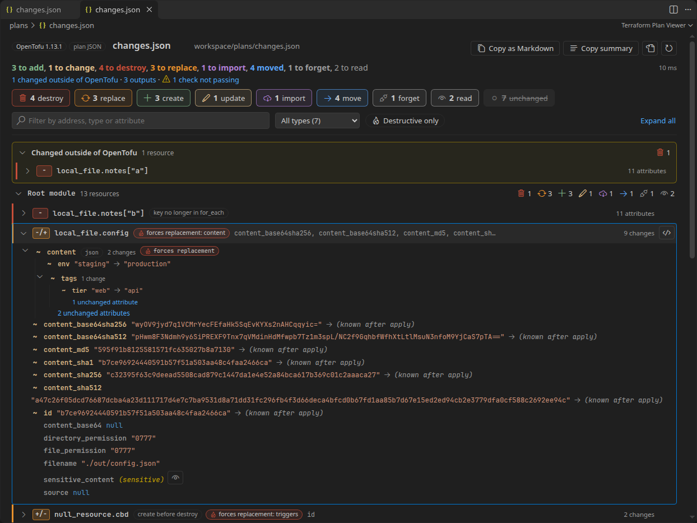
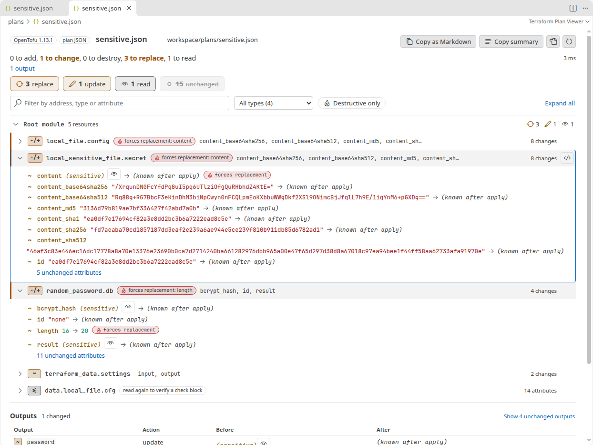
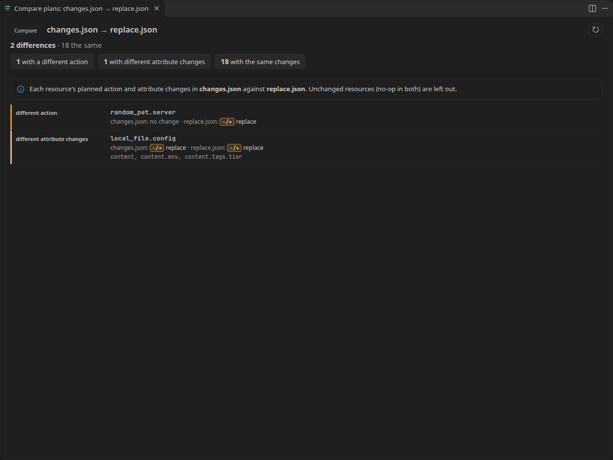

<h1 align="center">
  <br>
  Terraform Plan Viewer
</h1>

<p align="center">
  Read a Terraform or OpenTofu plan in a minute, inside VS Code.
</p>

<p align="center">
  <a href="https://github.com/heyliamme/terraform-plan-viewer/blob/main/CHANGELOG.md">Changelog</a> ·
  <a href="https://github.com/heyliamme/terraform-plan-viewer/blob/main/CONTRIBUTING.md">Contributing</a>
</p>



A `terraform plan` is a few hundred lines of text, and the thing you need to know, which
resources get destroyed and why, is somewhere in the middle. In a CI log it is also wrapped
in colour codes and timestamps. This extension reads the plan and shows what a reviewer
asks first:

- **The summary line** and a count for each action, destroys and replacements in front.
- **Destructive changes first**: destroyed and replaced resources are listed before the rest,
  with the attribute that forces the replacement, and whether the replacement is created
  before the old object is destroyed.
- **Before and after for every attribute**, nested objects and lists included, with only
  the changed attributes open; unchanged ones fold away. Values that are only known after
  apply say so. A string that holds JSON (`jsonencode(...)`) is shown as the JSON inside it.
- **Why**: moved from where, imported from which id, deleted because its `for_each` key is
  gone, replaced because it is tainted or was requested.
- **Sensitive values masked**, revealed one at a time; Copy as Markdown keeps them masked.
- **Drift** (changes made outside Terraform), **outputs**, and **checks and conditions**
  in their own sections.
- **Jump to the HCL block** of a resource in the workspace's `.tf` files, module by module.
- **Copy as Markdown** for a pull request comment: a summary table and each resource's
  changes in a folded `<details>` block.

It reads the plan JSON that `terraform show -json` writes, binary `.tfplan` files (through
`terraform` or `tofu` on your machine), and the plain text output of `terraform plan`,
pasted from a CI log or saved to a file, colour codes and all. Everything runs locally;
nothing is sent anywhere.

## Install

From the [Visual Studio Marketplace](https://marketplace.visualstudio.com/items?itemName=heyliam.terraform-plan-viewer),
from [Open VSX](https://open-vsx.org/extension/heyliam/terraform-plan-viewer) (VSCodium,
Cursor and other editors), or from a terminal:

```bash
code --install-extension heyliam.terraform-plan-viewer
```

## Getting started

Open a plan file and click the plan button in the editor's title bar (or press
<kbd>Ctrl</kbd>+<kbd>K</kbd> <kbd>T</kbd>, <kbd>Cmd</kbd>+<kbd>K</kbd> <kbd>T</kbd> on macOS).

| You have | Do this |
| --- | --- |
| Plan JSON (`terraform show -json plan.tfplan > plan.json`) | Open the file and click the title button, or right-click it in the Explorer (for JSON: a file with `plan` in its name, or one open in an editor): **Open as Terraform Plan**. Also under **Reopen Editor With…** |
| A binary plan (`terraform plan -out=plan.tfplan`) | Open the `.tfplan` file (or one named just `tfplan`): it opens in the viewer. Under any other name, use **Open Plan File…**. `terraform` or `tofu` must be on your `PATH` (or set `terraformPlanViewer.binaryPath`), and the plan's folder must be initialised, as `terraform show` needs it |
| The text of `terraform plan`, from a CI log, a terminal or a file | Copy it and run **Terraform Plan: Open Plan from Clipboard**, or save it and open the file as above. Colour codes, GitHub Actions and GitLab log decorations, and Markdown fences are stripped |
| Terraform files and a working directory | **Terraform Plan: Run Plan and Open…** runs `terraform plan -out` in a folder you pick, with progress and cancel, and opens the result. Nothing is kept on disk |
| Two plans, to see what changed between runs | Select both in the Explorer, right-click, **Compare Terraform Plans**; or **Compare with Another Plan…** from a plan file |

Files are recognised as plans by their content, whatever they are called: `format_version`
and `resource_changes` for JSON, the lines `terraform plan` writes for text. VS Code doesn't
pass files over 50 MB to extensions, so for those the title button doesn't appear: use
**Open Plan File…** or **Reopen Editor With…**.

## In the viewer

- **Counts** at the top are filters: click one to hide or show that action. Unchanged
  resources (no-op) are hidden until you ask for them.
- **Destructive only** keeps destroyed and replaced resources; the **type** list keeps one
  resource type; the **search box** matches the address, type, changed attribute names,
  the old address of a moved resource and the reason (its code or the words shown on the
  row): <kbd>/</kbd> jumps to it.
- **Click a resource** to open its attributes. Changed ones are shown; `n unchanged
  attributes` opens the rest. Long and multi-line values (user data, policies) are shown
  as a line diff.
- **(sensitive)** values have an eye button to reveal that one value; another click masks
  it again. `terraformPlanViewer.maskSensitive` turns masking off altogether.
- The **code button** (<code>&lt;/&gt;</code>) on a resource opens its `resource "type" "name"` block in the
  workspace's `.tf` files. For a resource in a module, the module's `source` is followed
  to the right folder. When several files declare the same block, you choose.
- **Copy as Markdown** and **Copy summary** put the plan on the clipboard for a pull request
  or a message.
- **Keyboard**: <kbd>↑</kbd> <kbd>↓</kbd> move through groups and resources, <kbd>→</kbd> and
  <kbd>Enter</kbd> open, <kbd>←</kbd> folds and goes up, <kbd>Home</kbd> / <kbd>End</kbd> jump.
  The tree is announced to screen readers as a tree.



A resource that **moved** (a `moved` block) is listed as a move with its old address; one
that moved and changed is listed under its change, with the old address alongside. An
**import** shows the id it is imported from; one that also changes shows both. A resource
**forgotten** (a `removed` block with `destroy = false`) is listed with its attributes as
they are. A **deposed** object (left over from a create-before-destroy replacement that
did not finish) is marked as such.

### Comparing two plans

**Compare Terraform Plans** lists, for each resource, whether it is only in one of the plans,
planned with a different action, or planned with the same action but different attribute
changes, with the attribute paths that differ. Resources unchanged in both are left out.



## Commands

All are under **Terraform Plan** in the Command Palette.

| Command | |
| --- | --- |
| Open as Terraform Plan | The current file, or the file the menu was opened on, in the viewer. |
| Open Plan File… | Pick a plan file anywhere on disk. |
| Open Plan from Clipboard | The clipboard as a plan: JSON or text, straight from a CI log. |
| Run Plan and Open… | `terraform plan -out` (or `tofu plan`) in a folder you pick, then the viewer. Only in a trusted workspace. |
| Compare with Another Plan… | The current plan file against another in the workspace, or one you browse to. |
| Compare Terraform Plans | Two plan files selected in the Explorer. |

## Settings

| Setting | Default | |
| --- | --- | --- |
| `terraformPlanViewer.binaryPath` | `""` | The `terraform` or `tofu` to use for binary plans and Run Plan: a name on `PATH` or a full path. Empty: the tool that wrote the plan (`tofu` or `terraform`, read from the plan file) is looked for on `PATH`, then the other. A user or machine setting: a workspace can't set it. |
| `terraformPlanViewer.planArgs` | `[]` | Extra arguments for Run Plan, such as `-var-file=prod.tfvars`. `-out`, `-chdir`, `-state`, `-state-out`, `-backup`, `-generate-config-out`, `-json` and `-input` are refused, and so is an argument that isn't an option (other than the value after `-var`, `-var-file`, `-target` and the like). A user or machine setting. |
| `terraformPlanViewer.maskSensitive` | `true` | Mask sensitive values until revealed one by one. |
| `terraformPlanViewer.destructiveFirst` | `true` | List destroyed and replaced resources first. Off: by address. |
| `terraformPlanViewer.showUnchanged` | `false` | Start with unchanged (no-op) resources listed too. |
| `terraformPlanViewer.showTimeoutSeconds` | `60` | How long `show -json` may take on a binary plan (up to a day). |
| `terraformPlanViewer.planTimeoutSeconds` | `900` | How long Run Plan may take (up to a day). It can also be cancelled from its notification. A stopped plan is interrupted, as <kbd>Ctrl</kbd>+<kbd>C</kbd> would, and given a minute to let go of the state lock. On Windows, where a process can only be ended, Run Plan plans with `-lock=false`: the plan is only read, never applied. |

## What is read

Plan JSON format versions 0.1 to 1.2 (Terraform 0.12 to 1.x) and OpenTofu's, including:
every action (`create`, `update`, `delete`, `delete` then `create`, `create` then `delete`,
`read`, `no-op`, `forget`), moved resources (`previous_address`), imports (`importing`),
replacement reasons and paths (`action_reason`, `replace_paths`), deposed objects, sensitive
and unknown values (`before_sensitive`, `after_sensitive`, `after_unknown`), resource drift
(`resource_drift`), relevant attributes, output changes, checks and conditions (`checks`),
variables, and whether the plan errored.

The text output of `terraform plan`, `terraform show plan.tfplan` and `tofu plan`, from
Terraform 0.12 onwards: resource headers and their reasons, nested blocks, maps and lists,
`jsonencode` values, heredoc strings with their line diffs, `# forces replacement`,
`(known after apply)`, `(sensitive value)`, the `Objects have changed outside` section,
`Changes to Outputs`, the `Plan:` line, and warnings and errors. Lines it cannot read are
listed under **Could not read**, and the `Plan:` line is checked against what was read.

The counts say `3 to replace` where Terraform says `3 to add, 3 to destroy`: replacements are
their own number here, because that is what a reviewer looks for.

## Large plans

A 20 MB plan JSON with 5,000 resource changes opens in about a second: the plan is parsed
once, the list shows rows as you scroll, and a resource's attributes are rendered when
you open it. Values are kept on the extension side, not in the view. Files over 150 MB are refused
(two plans being compared count together): parsing happens on the extension host, and a
plan that size already holds it for several seconds.

## Privacy and security

Everything runs locally. The extension makes no network requests, collects no telemetry,
and never writes, logs or stores plan content: a plan from the clipboard or a plan run
lives in memory for as long as its tab is open, and is gone after the window reloads
(a plan file reopens on its own). For a plan file, VS Code keeps the view's state across
reloads: which resources were open, the search text and folded modules, so these
addresses are in VS Code's workspace storage. For a plan from the clipboard, a run or an
unsaved editor, nothing of the plan is kept. Sensitive values are masked by default and stay masked
in Copy as Markdown.

`terraform` and `tofu` are started directly, never through a shell, with an argument list,
in the plan's folder, with a timeout. They never run in
[Restricted Mode](https://code.visualstudio.com/docs/editor/workspace-trust), where plan
JSON and text plans still open. Which binary to run can only come from your user or
machine settings, never from a workspace. Run Plan writes its `-out` file to a temporary
folder that is removed as soon as the plan has been read.

## Known limitations

- The text output is for people, not programs: it is read best-effort. What could not be
  read is listed rather than guessed, and unchanged attributes that Terraform left out
  (`# (3 unchanged attributes hidden)`) are counted but can't be shown. Prefer plan JSON
  when you have it.
- A binary plan can only be read by the Terraform or OpenTofu version that wrote it, in an
  initialised working directory: those are `terraform show`'s rules. The viewer tells
  `tofu` from `terraform` plans and reports the version it needs.
- Jump to HCL finds blocks by name in the open workspace; it cannot follow modules from a
  registry or a Git source, and it cannot tell `count` instances apart (they share one block).
- Run Plan uses the environment VS Code started with; cloud credentials set in a shell
  profile may not be there.
- The HashiCorp and OpenTofu extensions are not required; this one does not provide
  language features.

## Requirements

VS Code 1.90 or newer. Binary plans and Run Plan need `terraform` or `tofu` and a trusted
workspace.

## License

[MIT](LICENSE). The extension includes [Codicons](https://github.com/microsoft/vscode-codicons)
(CC BY 4.0 and MIT); see [ThirdPartyNotices.txt](ThirdPartyNotices.txt). Terraform is a
trademark of HashiCorp; OpenTofu is a trademark of the Linux Foundation. This extension is
not affiliated with either.
